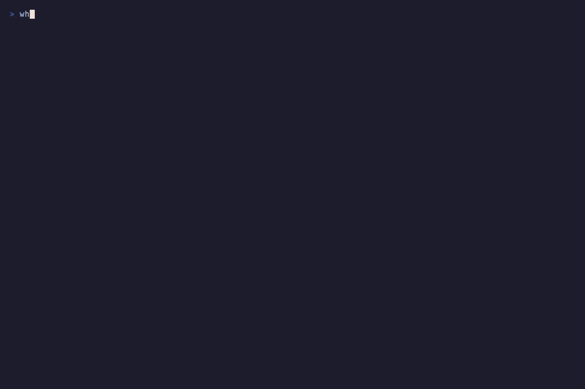

# whichllm

[](https://pypi.org/project/whichllm/)
[](https://www.python.org/downloads/)
[](https://opensource.org/licenses/MIT)
[](https://github.com/Andyyyy64/whichllm/actions/workflows/test.yml)
[](https://github.com/sponsors/Andyyyy64)

**手元のPCで実際に動く、いちばん賢いモデルを探します。動くとは思っていなかったモデルも候補に入ります。**

whichllm は GPU、RAM、メモリ帯域を調べて、どのオープンモデルが載るか、それぞれ何 tok/s で生成できるかを見積もります。そのうえでベンチマークの結果で順位を付けます。1位のモデルについては、見積もりと同じ配置で動かすためのコマンドも表示します。

[English version](../README.md)

## クイックスタート

```bash
uvx whichllm@latest
```

これから GPU を買うなら、その GPU をシミュレートできます。

```bash
uvx whichllm@latest --gpu "RTX 4090"
```

インストールして使う場合は次のどれかです。

```bash
uv tool install whichllm
brew install andyyyy64/whichllm/whichllm
pip install whichllm
```

## 実行例

8GB の RTX 4060 と 32GB の DDR4 を積んだデスクトップでの出力です（一部省略）。

```text
$ whichllm

 #  Model                         Quant   Fit       Speed     Score
 1  Qwen/Qwen3.6-35B-A3B          Q6_K    GPU+RAM   16 tok/s   68.8
 2  unsloth/gemma-4-12b-it-GGUF   IQ4_XS  Full GPU  37 tok/s   68.1
 3  google/gemma-4-26B-A4B-it     Q4_K_M  GPU+RAM   11 tok/s   64.5
 4  Qwen/Qwen3.5-9B               Q5_K_M  Full GPU  36 tok/s   64.2
 5  zai-org/GLM-4.7-Flash         Q5_K_M  GPU+RAM   15 tok/s   62.3

  #1 Qwen3.6-35B-A3B also stands in for older generations of its line:
  Qwen3.5-35B-A3B, Qwen3-30B-A3B, Qwen_Qwen3-30B-A3B-Instruct-2507-GGUF and 2 more

  Run #1 with llama.cpp:
    llama-server -hf unsloth/Qwen3.6-35B-A3B-GGUF:Q6_K -c 4096 -ngl 99 --n-cpu-moe 35 -fa on
```

8GB のカードで1位になったのは 35B のモデルです。これは mixture-of-experts（MoE）モデルで、1トークンの生成に使うパラメータは約 3B しかありません。whichllm は attention、共有の重み、KV キャッシュを VRAM に置き、40層のうち35層のエキスパートをシステム RAM に残します。llama.cpp の `--n-cpu-moe` と同じ配置です。速度は、1トークンごとに VRAM と RAM からそれぞれ読む量をもとに見積もります。VRAM に収まるかどうかだけで判定すればこのモデルは候補から外れ、普通の部分オフロードとして見積もれば遅すぎると判定されていたはずです。

24GB の RTX 4090 では、同じ計算で Qwen3.8-27B が1位になります。Qwen3-32B も Q4_K_M なら収まりますが、27B は同じ系列のほぼ同じサイズの新しい世代で、現行のベンチマークでもスコアが高いので、32B は別の行としては出さず、表の下の注記に名前を出します。

表示される速度はメモリ帯域からの推定で、あなたのマシンで測った値ではありません。推定がどのくらい確かかは表に表示されます。

## 順位の付け方

品質の評価には、Artificial Analysis と LiveBench のスコアを同じスケールにそろえて平均した値を使います。`--profile coding`、`math`、`vision` では、SciCode や LiveCodeBench のようなその用途のベンチマークで順位を付けます。Open LLM Leaderboard と Chatbot Arena は更新が止まっているので、現行のソースがどれも扱っていないモデルにだけ使います。古い世代のモデルは順位を下げます。ベンチマークのスコアをモデルにどう対応づけたか（リポジトリそのもの、ベースモデル、同じファミリーからの補間、アップローダーの自己申告）も記録し、根拠が弱いほどスコアを割り引きます。事前学習だけのベースチェックポイントは推薦しません。

収まるかどうかは、重み、KV キャッシュ、実行時のバッファの合計で判定します。KV キャッシュはモデルの `config.json` から層ごとに計算し、grouped-query attention、latent attention、スライディングウィンドウ、再帰層を区別します。VRAM に収まらない場合、MoE モデルはまずエキスパートを RAM に移し、それ以外のモデルは層単位で RAM に出します。

速度を決めるのはメモリ帯域です。GPU は担当分の重みを VRAM の速度で読み、残りは CPU が RAM の速度で読みます。どちらの値も llama.cpp での実測に合わせてあります。どの置き方でも 8 tok/s を基準にし、それより遅いモデルは品質のスコアを割り引きます。そのため、3 tok/s でしか答えられない賢いモデルが、25 tok/s で答えるモデルより上に来ることはありません。

詳しくは [スコアリング](scoring.md) と [仕組み](how-it-works.md) を参照してください。

## 推薦のテスト

推薦の間違いはバグとして扱うので、ランキングには回帰テストがあります（[`tests/golden/`](../tests/golden/)）。

- 4GB の GTX 1650 から 128GB の M4 Max や DGX Spark まで、AMD、Intel、異なる GPU の組み合わせ、CPU だけのマシン、32K/128K コンテキストの構成も含めた29のハードウェア構成を、インデックスを凍結したカタログ（1,441モデル、GGUF リポジトリの多くは実ファイルサイズ付き）でランキングします。
- 順位そのものは固定せず、良い推薦が満たすべき条件を30個の制約として書いています。たとえば、事前学習だけのチェックポイントやドラフトヘッド、拡散モデルを出さない、古い世代を上位5位に入れない、上位3件は（そこまで速い候補がある限り）8 tok/s の基準から 1 tok/s 以内に収まる、フル GPU の行は VRAM の余裕を残し Metal の上限に収まる、上位の行は `run` で起動できる、24GB 以上では最新の dense 27B が上位3位に入る、16GB のカードと 64GB の RAM ならエキスパートを RAM に置いた大きな MoE が上位5位に入る、コーディング向けの推薦が名前に「coder」を含むモデルに偏らない、などです。
- 速度とメモリの見積もりは、RTX 5080 とその CPU の実測に加えて、194 種類の GPU で公開された llama.cpp の結果 379 件と、138 種類の CPU の LocalScore の結果 255 件（[`tests/data/`](../tests/data/)）から決めた範囲に収まることをテストしています。見積もりがずれるとテストが失敗します。
- 全構成の上位候補を [`top_picks.md`](../tests/golden/top_picks.md) としてコミットしているので、ランキングが変わればレビューで diff として見えます。
- 失敗すると分かっている制約は、理由を添えて strict な expected failure として記録します。バグを直すとテストが失敗に変わるので、そこで記録を消します。

あなたのハードウェアでは使わないようなモデルが推薦されたら、出力を添えて issue を立ててください。6GB と RTX 3060 の構成は、そうした報告から追加しました（[#76](https://github.com/Andyyyy64/whichllm/issues/76)、[#104](https://github.com/Andyyyy64/whichllm/issues/104)）。

## コマンド

```bash
whichllm                          # このマシンに合うモデル
whichllm --gpu "RTX 5060 Ti"      # GPU をシミュレート（VRAM 違いは --vram 16 を追加）
whichllm --gpu "2x RTX 3090"      # 複数枚も指定できる
whichllm --profile coding         # general, coding, vision, math, any
whichllm --context-length 64k     # コンテキストが長いと収まるモデルが変わる
whichllm --gpu-only               # VRAM に全部載るモデルだけ
whichllm --speed usable           # 8 tok/s 未満を隠す
whichllm --markdown               # issue やチャットに貼れる表
whichllm --json                   # 配置と実行コマンドも含む

whichllm hardware                 # 検出したハードウェア
whichllm plan "qwen3 32b"         # モデルに必要な GPU
whichllm upgrade "RTX 4090" "RTX 5090"   # 購入候補の GPU と比較
whichllm run                      # 1位をダウンロードしてチャット
whichllm bench                    # 1位の実際の速度をこのマシンで測る
whichllm report                   # 測った結果を GitHub Issue で共有
whichllm snippet                  # 1位を読み込む Python コードを表示
```

オプションの一覧は [CLI リファレンス](cli.md) にあります。

LM Studio で推薦されたモデルが少しはみ出す場合は、余裕を持たせた判定にします。

```bash
whichllm --gpu-only --speed usable --vram-headroom 1.5GB
```

内蔵 GPU やユニファイドメモリの上限が正しく検出されない場合は、`--vram` と `--ram-bandwidth` で上書きできます（[ハードウェア](hardware.md) を参照）。

## run と snippet

`whichllm run` はモデルをダウンロードしてチャットを開きます。モデル名を省くと1位のモデルを使います。



```bash
whichllm run
whichllm run "qwen 2.5 1.5b gguf"
whichllm run "phi 3 mini gguf" --cpu-only
```

llama.cpp が入っていれば（`brew install llama.cpp`、`winget install ggml.llamacpp`）、GGUF のモデルは表示したレシピと同じフラグで `llama-cli` を使って動かします。GPU を使い、MoE のエキスパートはランキングの見積もりどおり RAM に置きます。モデル名を指定したときは、配置は llama.cpp の自動調整に任せます。

llama-cli がなければ、`uv` で使い捨ての環境を作り、GGUF は `llama-cpp-python`、それ以外は `transformers` で動かします。PyPI の llama-cpp-python はソースしかないため、初回はその場でビルドします。Core Ultra 9 で 22 分かかり、できあがるのは CPU でしか動かない版です。詳しくは [run と snippet](run-snippet.md) を参照してください。

## データの出どころ

whichllm は事前に作ったインデックスを読み込むので、初回の起動は約1秒で済み、Hugging Face API も呼びません。インデックスの中身は Hugging Face のモデル一覧、各ファミリーの `config.json`、統合したベンチマークスコアです。GitHub Actions で毎日作り直し、品質チェックを通ったときだけ公開します。`--live` を付けるとすべてを直接取得し、`HF_TOKEN` が設定されていればそれを使います。

## ドキュメント

ドキュメントは英語です。

- [CLI リファレンス](cli.md)
- [仕組み](how-it-works.md)
- [スコアリング](scoring.md)
- [ハードウェアの検出とシミュレーション](hardware.md)
- [run と snippet](run-snippet.md)
- [トラブルシューティング](troubleshooting.md)

## 開発

```bash
git clone https://github.com/Andyyyy64/whichllm.git
cd whichllm
uv sync --locked --dev
uv run whichllm
uv run pytest
```

ランキングが変わる変更では、`uv run python scripts/update_golden.py report` で golden のスナップショットを確認してください。詳しくは [CONTRIBUTING.md](../CONTRIBUTING.md) にあります。

## サポート

whichllm のおかげで無駄なダウンロードやハードウェアの買い間違いを避けられたら、スポンサーになってもらえると保守を続けやすくなります。ハードウェアの報告への対応、ベンチマークの更新、パッケージング、対応マシンの追加に使います。スポンサーがあってもなくても、オープンソースのままです。

スターを付けてもらえると、ほかの人が見つけやすくなります。あなたのマシンで何が選ばれたかも知りたいので、[Issues](https://github.com/Andyyyy64/whichllm/issues) に気軽に書いてください。

## Star History

[](https://star-history.dera.page/#Andyyyy64/whichllm&Date)

## ライセンス

MIT
