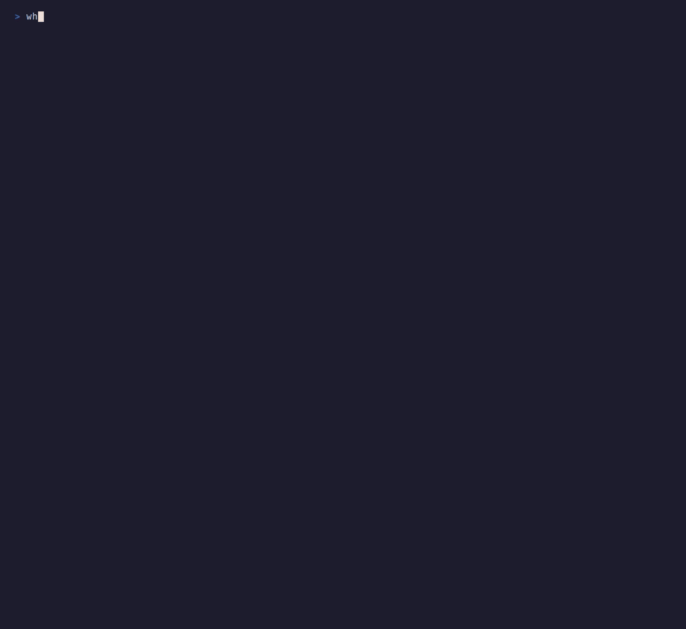

# whichllm

**手元のハードウェアで実際に動くローカルLLMを探すCLIです。**

whichllm は GPU / CPU / RAM / ディスクを検出し、HuggingFace 上のモデルを
取得して、実行できる候補をランキングします。単に「VRAMに入る最大モデル」を
選ぶのではなく、ベンチマーク、量子化、速度、実行形態、モデル世代をまとめて
評価します。

[English version](../README.md)



## インストール

### uv

一度だけ試す場合:

```bash
uvx whichllm@latest
```

継続して使う場合:

```bash
uv tool install whichllm
uv tool upgrade whichllm  # 既存インストールを更新
```

### Homebrew

```bash
brew install andyyyy64/whichllm/whichllm
```

### pip

```bash
pip install whichllm
```

## 余裕を持って動く候補だけ見たい場合

whichllm のデフォルトは少し攻めた推薦です。RAMへのpartial offloadや、
VRAMぎりぎりの候補も、動きそうならランキングに入れます。

LM Studioなどで余裕を持って動かしたい場合は、まずこれを使ってください。

```bash
uvx whichllm@latest --gpu-only --speed usable --vram-headroom 1GB
```

GPUのVRAMに全部載る候補だけに絞り、遅い推定速度の候補を外し、実行時の
余白も1GB残します。

それでもLM Studio側で少しはみ出す場合は、余白を増やします。

```bash
uvx whichllm@latest --gpu-only --speed usable --vram-headroom 1.5GB
```

### 開発用

```bash
git clone https://github.com/Andyyyy64/whichllm.git
cd whichllm
uv sync --locked --dev
uv run whichllm
uv run pytest
```

## まず使う

```bash
# 自動検出しておすすめモデルを表示
whichllm

# GPUをシミュレートする
whichllm --gpu "RTX 4090"
whichllm --gpu "Apple M3 Max"

# 複数GPUをシミュレートする
whichllm --gpu "2x RTX 4090"
whichllm --gpu "RTX 4090" --gpu "RTX 3090"

# GPUのVRAMに全部載る候補だけを見る
whichllm --gpu-only
whichllm --fit gpu

# 速度の最低ラインを指定する
whichllm --speed usable
whichllm --speed fast
whichllm --min-speed 4

# GitHubやSlackに貼りやすいMarkdown表で出力する
whichllm --markdown

# 実行時のメモリ余白やRAM使用量を指定する
whichllm --vram-headroom 1.5GB
whichllm --ram-budget available

# CPUのみとして評価する
whichllm --cpu-only

# JSONで出力する
whichllm --json
```

JSONの各モデルには `estimated_tok_per_sec` に加えて、`fit_type`、
`vram_required_bytes`、`vram_available_bytes`、`uses_multi_gpu`、
`multi_gpu_effective_vram_bytes`、`speed_confidence`、
`speed_range_tok_per_sec`、`speed_notes`、`benchmark_source`、
`benchmark_confidence` が入ります。
速度は実測値ではなく、ハードウェア情報とモデル情報からの推定です。
通常の表には必要メモリ、推定生成速度、Fit種別、Published が表示されます。
Downloads まで見たい場合は `--details` を使います。
GitHub issue、README、Slack、Discord へ貼る場合は `--markdown` / `-m`
でMarkdown表として出力できます。

## 主なコマンド

```bash
# 推薦ランキング
whichllm --top 20
whichllm --quant Q4_K_M
whichllm --min-speed 30
whichllm --speed usable
whichllm --speed fast
whichllm --markdown
whichllm --profile coding
whichllm --context-length 64k
whichllm --details
whichllm --gpu-only

# ベンチ根拠の厳しさ
whichllm --evidence strict
whichllm --evidence base
whichllm --direct

# モデルから必要GPUを逆算
whichllm plan "llama 3 70b"
whichllm plan "Qwen2.5-72B" --quant Q8_0
whichllm plan "mistral 7b" --context-length 32768

# 今のマシンと購入候補GPUを比較
whichllm upgrade "RTX 4090" "RTX 5090" "H100"

# モデルをダウンロードしてチャット
whichllm run "qwen 2.5 1.5b gguf"
whichllm run

# 実行用Pythonコードを表示
whichllm snippet "qwen 7b"

# ハードウェア情報だけ表示
whichllm hardware
```

## スコアの見方

各モデルには 0 から 100 のスコアが付きます。中心になるのはベンチマークと
モデルサイズですが、実行時に遅すぎる候補や、CPUオフロードが大きい候補は
下がります。

| 要素 | 役割 |
| --- | --- |
| ベンチマーク | LiveBench、Artificial Analysis、Aider、Vision、Arena、Open LLM Leaderboard を統合 |
| モデルサイズ | 知識量の近似。MoEは総パラメータを使う |
| 量子化 | Q4 / Q5 / Q6 / Q8 などの品質低下を反映 |
| 実行形態 | Full GPU、Partial Offload、CPU-only を区別 |
| 速度 | tok/s が実用ラインを下回ると減点。表示時は推定の信頼度と幅も出す |
| 根拠の強さ | direct、base_model、variant、line_interp、self_reported を区別 |
| 世代補正 | 古い凍結ベンチだけで新世代を上回らないよう調整 |

スコア横のマーカー:

- `~`: 直接ベンチではなく、系列や派生から推定したスコア
- `!sr`: アップローダー自己申告の評価値だけに基づくスコア
- `?`: 利用できるベンチマーク根拠がないスコア

速度表示:

- 赤: `4 tok/s` 未満の遅い生成速度
- 黄: `4-10 tok/s` のぎりぎり使える生成速度
- 緑: `10-30 tok/s` の実用的な生成速度
- 明るい緑: `30 tok/s` 以上の高速なローカル生成速度
- `~`: 速度推定の幅がある通常の推定値
- `?`: backend や runtime の影響が大きい低信頼の推定値

## 仕組み

1. ハードウェアを検出します。NVIDIA、AMD、Intel、Apple Silicon、CPU、RAM、
   ディスク空き容量を見ます。
2. HuggingFace APIからモデルを取得します。人気モデル、GGUF、最近更新された
   GGUF、trending、重要な frontier モデルを組み合わせます。
3. ベンチマークを読み込みます。現在系の LiveBench / Artificial Analysis /
   Aider / Vision と、凍結系の Arena / Open LLM Leaderboard を分けて扱います。
4. `base_model` とモデル名からファミリーを作り、同じモデルの派生やGGUFを束ねます。
5. 候補ごとに VRAM、互換性、速度、速度推定の信頼度、スコアを計算します。
6. ファミリーごとに最も良い候補を残して表示します。

通常は full GPU、partial offload、CPU-only の候補をまとめて見ます。GPUの
VRAMに全部載るモデルだけを見たい場合は `--gpu-only` か
`--fit gpu` を使います。遅い候補を最初から除外したい場合は
`--speed usable`、`--speed fast` を使います。
それぞれ `10 tok/s`、`30 tok/s` が最低ラインです。
もっと低いラインを指定したい場合は `--min-speed 4` のように数値で指定します。

キャッシュは通常 `~/.cache/whichllm/` に保存されます。`XDG_CACHE_HOME` が
絶対パスで設定されている場合は、その配下の `whichllm/` を使います。

- `models.json`: 6時間
- `benchmark.json`: 24時間

## プロジェクト構成

```text
src/whichllm/
├── cli.py              # Typer CLI: main, plan, upgrade, run, snippet, hardware
├── constants.py        # 互換用のregistry再export
├── data/               # GPU、量子化、framework、lineageのregistry
├── hardware/           # ハードウェア検出とGPUシミュレーション
├── models/             # HuggingFace取得、ベンチ、キャッシュ、グルーピング
├── engine/             # VRAM、互換性、速度、ランキング
└── output/             # Rich表示、JSON、plan/upgrade表示
```

## 詳細ドキュメント

- [CLIリファレンス](cli.md)
- [仕組み](how-it-works.md)
- [スコアリング](scoring.md)
- [ハードウェア検出とシミュレーション](hardware.md)
- [run と snippet](run-snippet.md)
- [トラブルシュート](troubleshooting.md)

## 動作環境

- Python 3.11+
- NVIDIA GPU検出は `nvidia-ml-py` と `nvidia-smi` fallback
- AMD GPU検出は Linux / ROCm / sysfs / lspci と Windows fallback
- Intel GPU検出は Linux / sysfs / lspci と Windows fallback
- Strix Halo、Ryzen AI MAX、Radeon 890M 系は shared memory APU として扱う
- Apple Silicon検出は macOS / `system_profiler`

## ライセンス

MIT
